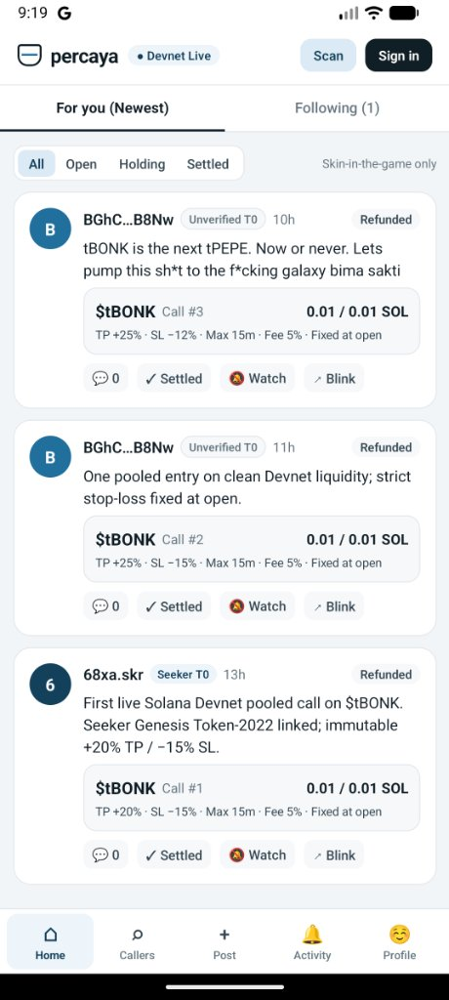
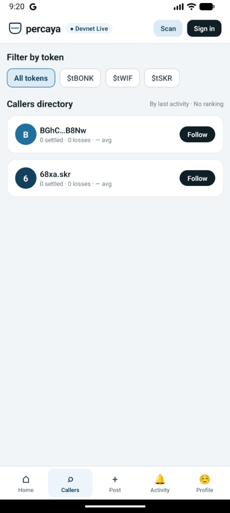
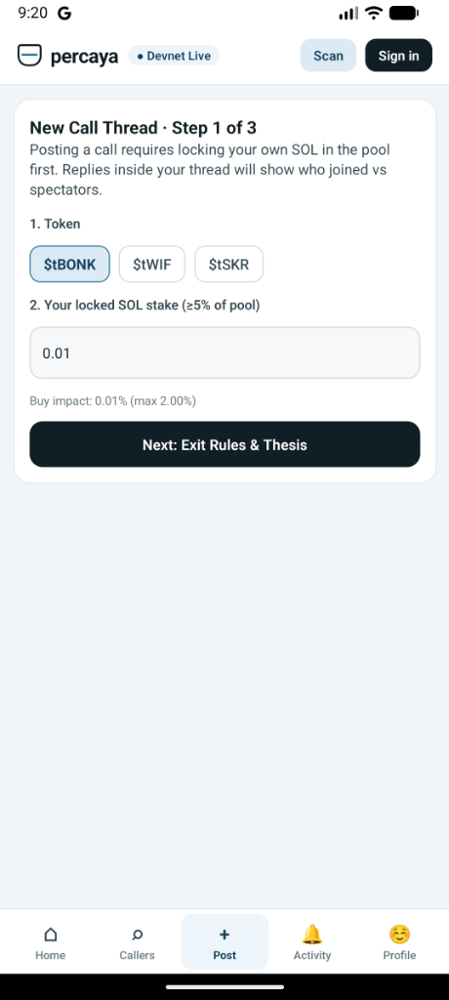
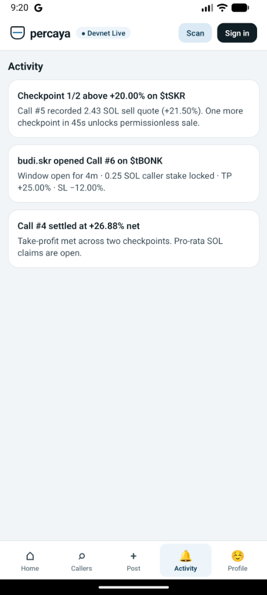
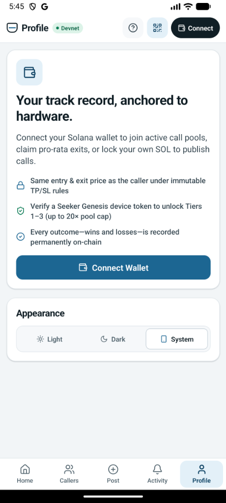
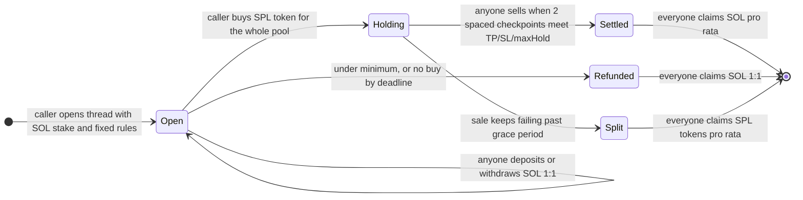
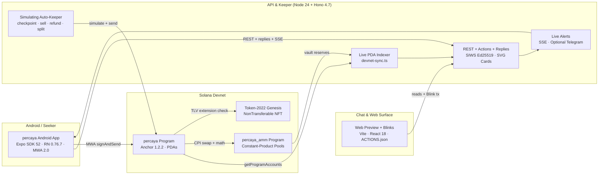

# percaya

**One buy. One sale. The same price for everyone.**

`percaya` (Indonesian for *trust*) is a **Skin-in-the-Game Threads** mobile dApp built natively for **Solana Mobile Seeker**. Every root post in the feed is an immutable on-chain pooled call: a caller picks one SPL token, fixes every exit rule up front, and locks their own SOL first. Followers join from the Android app—or in one tap from a Telegram/X Solana Blink—while the window is open, and every reply inside the thread automatically carries an on-chain position badge (`In Pool · 0.50 SOL` vs `Spectator`).

The pool buys once for everyone, sells once for everyone when two spaced on-chain price checkpoints meet a rule, and every participant—the caller included—ends with the exact same percentage return. The net result stays permanently on the caller's on-chain record, bound at Tiers 1–3 to a 1-per-device **Token-2022 `NonTransferable` Seeker Genesis NFT**.

[](programs/percaya)
[](programs/percaya/tests/test_percaya.rs)
[](#deployment)
[](apps/mobile/src/mwa.ts)
[-000020)](apps/mobile)
[](apps/api)
[](LICENSE)

> **For Hackathon Judges (Zero Setup Required):**
> - **Download Signed Release APK (`v0.1.0`, RSA-2048):** [`percaya-v0.1.0-devnet.apk`](https://github.com/rebelchain/percaya/releases/download/v0.1.0/percaya-v0.1.0-devnet.apk) · ([Release Notes & SHA-256](https://github.com/rebelchain/percaya/releases/tag/v0.1.0))
> - **Live Web Preview, Blinks & Compliance Pages:** [https://percaya.duckdns.org](https://percaya.duckdns.org) · ([Privacy](https://percaya.duckdns.org/privacy) · [Terms](https://percaya.duckdns.org/terms))
> - **90-Second Testing Walkthrough:** [Jump to Judge Quick Test](#judge-quick-test-90-seconds-on-apk)

### Android App Preview (`percaya` on Solana Devnet)

<table>
  <tr>
    <td align="center"><br /><sub><b>Home · Devnet Live</b></sub></td>
    <td align="center"><br /><sub><b>Callers · No Ranking</b></sub></td>
    <td align="center"><br /><sub><b>+ Post · Lock SOL</b></sub></td>
    <td align="center"><br /><sub><b>Activity · Alerts</b></sub></td>
    <td align="center"><br /><sub><b>Profile · MWA 2.0</b></sub></td>
  </tr>
</table>

---

## Contents

[The problem](#the-problem) · [Skin-in-the-Game Threads & Seeker](#skin-in-the-game-threads--seeker) · [How it works](#how-it-works) · [Worked example](#worked-example) · [Architecture](#architecture) · [Guarantees](#guarantees) · [Deployment](#deployment) · [Judge quick test](#judge-quick-test-90-seconds-on-apk) · [Getting started](#getting-started) · [Testing](#testing) · [Tech stack](#tech-stack) · [Repository](#repository) · [Mainnet roadmap](#mainnet-roadmap--skr-business-alignment) · [Known limits](#known-limits) · [Documentation](#documentation) · [AI usage](#ai-usage--human-verification) · [Team & origin](#team--origin)

---

## The problem

Call groups on Telegram and X move millions in Solana tokens with zero consequence for the caller. A caller can buy early, post the ticker, sell into their followers' buying, delete the message when it goes wrong, and spin up a fresh burner wallet with a clean history. Followers carry the downside and never see the caller's actual fills.

`percaya` removes the head start mechanically instead of trying to police chat rooms. The caller's SOL rides in the same pool, at the same entry and exit price, under rules nobody can change after open, and every outcome—losses included—stays on an on-chain record anchored to hardware identity.

---

## Skin-in-the-Game Threads & Seeker

Crypto calls happen on phones, inside mobile chat feeds, with windows measured in minutes. Adapting pooled accountability to **Solana Mobile Seeker** solves three problems at once:

1. **No free shilling (`Call-as-a-Thread`).** The mobile app follows the familiar 5-tab **Threads** pattern (`Home`, `Callers`, `+ Post`, `Activity`, `Profile`) with `For you (Newest)` and `Following` feeds—except **you cannot publish a root post without locking SOL in an on-chain pool**. Inside any thread, replies signed via SIWS automatically display whether the commenter actually put SOL in (`In Pool · 0.50 SOL`) or is watching from the sidelines (`Spectator`).
2. **Closing burner-wallet resets (`Seeker Genesis Token` + `GenesisRegistry` PDA).** On standard chains, a ruined caller spins up a fresh keypair for free. Even on Seeker, a user can move their Seeker Genesis Token (SGT) between internal Seed Vault sub-accounts while the SGT's **mint address stays identical**. In `percaya`, Tiers 1–3 (`5×` to `20×` bond cap) require binding that 1-per-device **Token-2022 Seeker Genesis NFT** into a one-time `init` `GenesisRegistry` PDA keyed by **`[b"genesis", genesis_mint]`** (not merely the wallet address). One physical device maps to one permanent track record; a slash taints that `genesis_mint` permanently. Unverified wallets remain capped at Tier 0 (`2×` bond, `5%` max fee) and are labelled openly (tap any tier pill in the app to inspect its cap rules).
3. **Built for the phone in your pocket (`Camera QR` + `Android Push` + `MWA 2.0` + `Solana Blinks`).** Every call exposes an in-app **SVG QR code** (`percaya://c/:id`) that other Seeker/Android phones can scan directly via the built-in **`expo-camera` QR scanner**, native **Android push notifications** (`expo-notifications`) when watched or joined pools buy/settle/refund/split, and a Solana Action endpoint (`/actions.json` + `/api/actions/call/:id`) so followers sign deposits via **Mobile Wallet Adapter 2.0** (Seed Vault, Solflare, Phantom, or Fake Wallet) — even on a cold-installed APK with zero local backend via our on-device Devnet RPC engine (`chain-direct.ts`).

---

## How it works



1. **Bond & Hardware Link.** A caller registers (`register_caller`), posts a SOL bond (`post_bond`), and optionally verifies their Token-2022 `NonTransferable` Seeker Genesis NFT (`verify_seeker_genesis`). The bond stays locked while any call is open or holding and can be slashed with a public on-chain reason.
2. **Open.** The caller selects an allowed SPL token, fixes the join window, take-profit, stop-loss, max hold, profit share and thesis (`<= 280` bytes), and locks their SOL stake (`open_call`). Every rule, timing bound and AMM pool pubkey is snapshotted into `CallPool` and never changes.
3. **Join.** While the window is open, anyone deposits SOL (`init_position` + `deposit`) or withdraws it 1:1 (`withdraw`). Deposits revert if they exceed the bond tier cap, push buy price impact past `2%`, or dilute the caller below `5%`. The caller cannot withdraw.
4. **Buy.** After the window closes, the caller runs one CPI swap (`buy`) for the entire pool. The program enforces minimum size, cap, caller share (`>= 5%`) and closed-form `u128` buy price impact (`<= 2%`), and records the actual token balance delta received in `call_token_vault`.
5. **Checkpoints.** Anyone can call `checkpoint` once per `checkpoint_gap`, storing what selling the whole token vault into the AMM would return right now.
6. **Sell.** Anyone can call `sell` when two checkpoints (at least one `checkpoint_gap` apart, with the latest still fresh) both meet take-profit, both meet stop-loss, or agree within `2%` at `max_hold`. The program computes `min_out` on chain and pays `0.1%` of gross proceeds to the keeper signer.
7. **Claim.** Each participant claims once (`claim`). The final claimant (`claims_left == 1`) sweeps `pot - claimed_amount` so zero lamports or tokens are ever stranded.

### Reputation tiers

| Tier | Requirement | Seeker Genesis | Pool cap | Max profit share |
|---|---|---|---|---|
| **0** | `< 3` settled, average net `<= 0`, unverified wallet, or ever slashed | Optional | `2 × bond` | `5%` |
| **1** | `>= 3` settled, average net `> 0`, never slashed | **Required** | `5 × bond` | `10%` |
| **2** | `>= 10` settled, average net `> 0`, never slashed | **Required** | `10 × bond` | `15%` |
| **3** | `>= 25` settled, average net `> 0`, never slashed | **Required** | `20 × bond` | `20%` |

---

## Worked example

`20 SOL` pooled (caller `2 SOL`, A `6 SOL`, B `8 SOL`, C `4 SOL`), `10%` profit share, sold for `26 SOL` gross (`1 SOL = 1,000,000,000 lamports`). Exact integer math is verified to the single lamport in `packages/core/src/math.test.ts` and `programs/percaya/tests/test_percaya.rs`:

```text
keeper  = 26.0000 × 0.1%              =   0.0260 SOL    (26,000,000 lamports)
net     = 26.0000 − 0.0260            =  25.9740 SOL
profit  = net − 20.0000               =   5.9740 SOL
fee     = 10% of profit               =   0.5974 SOL
payout  = net − fee                   =  25.3766 SOL    shared pro rata, caller included

caller   3.1350 SOL   (2.5376 share + 0.5974 fee)
A 7.6129 SOL · B 10.1506 SOL · C 5.0753 SOL
every participant: +26.88% · on-chain record: +26.88% (+2688 bps)
```

Sold for `14 SOL` gross instead, keeper receives `0.0140 SOL`, `net = 13.9860 SOL`, `profit = 0`, `fee = 0`. Everyone—the caller included—ends at **`−30.07%`** (`-3007 bps`), and the caller's record logs a loss of `−30.07%`.

---

## Architecture



---

## Guarantees

| Guarantee | How the Anchor program enforces it |
|---|---|
| Rules are final | Every rule, timing bound and AMM pool pubkey is copied into `CallPool` at `open_call`. No instruction—admin included—mutates an active call's rules. |
| No `init_if_needed` footguns | Explicit initialization paths (`register_caller`, `register_token`, `init_position`) composed atomically in one transaction. |
| Caller is in first and stays in | `open_call` transfers the caller's SOL stake into `SolVault`; `withdraw` rejects `caller`; `deposit` and `buy` enforce `caller_stake >= 5%` of `total_in`. |
| One entry, one exit | `buy` swaps the entire `SolVault` once; `sell` swaps the entire `call_token_vault` once. No individual exit path exists while `Holding`. |
| No sale on a single-slot push | `sell` requires two on-chain checkpoints at least `checkpoint_gap` apart, with the latest at most one `checkpoint_gap` old, and computes `min_out` on chain. |
| Stray-lamport & rent-floor safety | `SolVault`, `BondVault`, and `AmmSolVault` are 0-byte `SystemAccount` PDAs seeded with `Rent::minimum_balance(0)`. Accounting tracks state fields and swap deltas only; unsolicited SOL donations cannot break claims. |
| Profit-only fee | `fee = max(net - total_in, 0) * share_bps / 10_000`. Zero fee on break-even, loss, refund or split. |
| Hardware-bound higher tiers | Tiers 1–3 require a verified Token-2022 `NonTransferable` Genesis NFT bound in `GenesisRegistry` (`init` once per mint). |
| Zero stranded dust | Refunds (`1:1`), token splits (`0` fee), and the final claimant (`claims_left == 1`) sweeping `pot - claimed_amount`. |
| Admin has no path to pool funds | Admin instructions touch `GlobalConfig`, `AllowedToken` PDAs, and `CallerRecord` bonds (on public slash) only—never `SolVault` or `call_token_vault`. |

---

## Deployment

Live on **Solana Devnet** (`packages/core/src/devnet-deployment.json`, deployed and seeded 27 November 2026):

| Component | Address / Signature | Explorer |
|---|---|---|
| **Live Web Preview & Blinks API** | `https://percaya.duckdns.org` (`DATA=chain`, 24/7 Auto-Keeper + `/api/faucet`) | [Open Web](https://percaya.duckdns.org) · [Privacy](https://percaya.duckdns.org/privacy) · [Terms](https://percaya.duckdns.org/terms) |
| **`percaya` Program** | `8ZMPKC79FfVvKsQXudDUJfGmmSMRd1HkY2QU7anrCcf6` | [Solana Explorer](https://explorer.solana.com/address/8ZMPKC79FfVvKsQXudDUJfGmmSMRd1HkY2QU7anrCcf6?cluster=devnet) |
| **`percaya_amm` Program** | `AzU89s97v6XKT8oKkyV82p2k17z1eK2aFhGwrXTpquxz` | [Solana Explorer](https://explorer.solana.com/address/AzU89s97v6XKT8oKkyV82p2k17z1eK2aFhGwrXTpquxz?cluster=devnet) |
| **`GlobalConfig` PDA** | `F559AB2MjAZModvfDw9oqqpy8gNEuS3AFYZbFTii8aa7` | [Solana Explorer](https://explorer.solana.com/address/F559AB2MjAZModvfDw9oqqpy8gNEuS3AFYZbFTii8aa7?cluster=devnet) |
| **`$tBONK` Mint / AMM Pool** | `5Y5uHKf…gukR` / `GgTd1UV5SPntSPfsJVEsWafvMk7EWJyQ6i5YwAsNzuiH` | [Pool](https://explorer.solana.com/address/GgTd1UV5SPntSPfsJVEsWafvMk7EWJyQ6i5YwAsNzuiH?cluster=devnet) |
| **`$tWIF` Mint / AMM Pool** | `AVdTeM9…JLDn` / `DTE5Ujr19xh982gGN2h67tdMrYGDpxtsTv1eJaSknxmw` | [Pool](https://explorer.solana.com/address/DTE5Ujr19xh982gGN2h67tdMrYGDpxtsTv1eJaSknxmw?cluster=devnet) |
| **`$tSKR` Mint / AMM Pool** | `F1vMDdV…Yyip` / `4XmQwqt8su3HrsSCmtDXx4iXzj3zcMZCkEmdiwUCE4i6` | [Pool](https://explorer.solana.com/address/4XmQwqt8su3HrsSCmtDXx4iXzj3zcMZCkEmdiwUCE4i6?cluster=devnet) |
| **Token-2022 Seeker Genesis NFT** | `GsRTNhTYJg4RG7NgJ8enT1wGAvEfghhchjy25f8WmBLL` | [Mint](https://explorer.solana.com/address/GsRTNhTYJg4RG7NgJ8enT1wGAvEfghhchjy25f8WmBLL?cluster=devnet) |
| **Live Devnet Call #1 (`open_call`)** | `3tJumYzk…919bjNBa1` | [Transaction](https://explorer.solana.com/tx/3tJumYzkJAXEG344kjWZkDtjngnNzVMdRYgB9SWDjngYT8UFVRMXKEHsRNMfkE3codqx93cTxg15Ebi919bjNBa1?cluster=devnet) |
| **Live Devnet Call #3 (MWA 2.0 APK)** | `2oY9YPJbS97BBdPsJG…` | Signed live on standalone `app-release.apk` via Solflare MWA |
| **Live Devnet AMM Swap (`move-price`)** | `2wwPbx8G…V3n7GmGQ` | [Transaction](https://explorer.solana.com/tx/2wwPbx8GJa9Dsh2s5Y9w75i6py5hmqK8KoJUMUdCs9SaT6FCVUGwo5bz2XXXfc8WCoRGu6yx2Zs4F2oQV3n7GmGQ?cluster=devnet) |

**Devnet demo parameters:** `0.05 SOL` min bond, `0.01 SOL` min pool, `60s–600s` windows, `120s–1800s` max hold, `45s` checkpoint gap, `2%` max buy price impact, `0.1%` keeper reward.

---

## Judge quick test (90 seconds on APK)

No local backend or `adb reverse` is required to evaluate the Android APK:

1. **Download & install [`percaya-v0.1.0-devnet.apk`](https://github.com/rebelchain/percaya/releases/download/v0.1.0/percaya-v0.1.0-devnet.apk)** on a Solana Seeker, physical Android device, or Android Emulator (with Seed Vault, Solflare Devnet, Phantom Devnet, or MWA Fake Wallet):
   ```bash
   curl -fSL -o percaya-v0.1.0-devnet.apk https://github.com/rebelchain/percaya/releases/download/v0.1.0/percaya-v0.1.0-devnet.apk
   adb install -r percaya-v0.1.0-devnet.apk
   ```
2. **First-launch Welcome Guide & 4-Step Interactive Checklist:** On cold boot, a calm 3-point guide introduces the mechanics (re-openable anytime via **`?`** in the header) alongside an interactive **Getting Started (0/4)** card at the top of `Home` while live PDAs load (`● Devnet Live`).
3. **Connect via MWA 2.0:** Tap **`Sign in`** (supports 1-prompt SIWS and automatically falls back to standard `authorize` for Fake Wallet).
4. **1-Tap `Claim Judge Test SOL` + Live `Verify Seeker Genesis`:** Fund `+0.08 Devnet SOL` if your wallet holds `< 0.06 SOL`, then tap **`Verify SGT`** (in the checklist or `Profile` tab) to mint & bind a real Token-2022 `NonTransferable` Seeker Genesis NFT to `GenesisRegistry` on Solana Devnet in one MWA swipe.
5. **Sign on Devnet + Test Native Phone Features:**
   - Tap **`+ Post`** to open an immutable pooled call on `$tBONK`, `$tWIF`, or `$tSKR` (auto-bundles `register_caller + post_bond + open_call` in 1 MWA prompt) or join an `Open` pool.
   - Tap **`QR`** inside any Call thread to display its scannable `percaya://c/:id` QR code, or tap **`Scan`** in the top bar to scan `docs/assets/qr-call-3.png` with the native camera.
   - Tap **`🔔 Watch`** on any call to enable native Android system notifications when its on-chain state transitions.

---

## Getting started

**1. API & Web Preview (Demo fixtures, no RPC required):**

```bash
npm install
npm run dev:api          # http://localhost:8787 (DATA=demo)
npm run dev:web          # http://localhost:5173
```

**2. Live Solana Devnet mode (`DATA=chain` + Auto-Keeper):**

```bash
npm run dev:api:chain    # Polls live Devnet PDAs every 15s & runs simulating Keeper
```

**3. Trigger a live Devnet price move (for TP/SL demos):**

```bash
npm run move:price -- --token tBONK --sol 0.15
```

**4. Android Native App (`apps/mobile`, requires Android Studio / SDK):**

```bash
cd apps/mobile
npm install
npx expo prebuild --platform android
npx expo run:android     # Installs debug dev-client APK onto connected Emulator / Android device
# Standalone signed release APK:
cd android && ./gradlew assembleRelease
```

---

## Testing

```bash
# 1. Solana Anchor programs — 4/4 LiteSVM end-to-end simulation tests (0.52s)
cargo test

# 2. Shared fixed-point math & settlement invariants — 6/6 tests
node --experimental-strip-types --test packages/core/src/math.test.ts

# 3. API, SIWS Ed25519, Thread Replies, SGT Issuance & Solana Blinks — 4/4 tests
npm run test:api

# 4. Mobile QR parser, notification diff, onboarding checklist & release signing — 10/10 tests
(cd apps/mobile && npm run test)

# 5. Full TypeScript check & Web production bundle
npm run typecheck
(cd apps/mobile && npm run typecheck)
npm --workspace @percaya/web run build
```

---

## Tech stack

| Layer | Actual stack implemented |
|---|---|
| Solana Programs | Rust (`1.89.0` / SBF `v1.57`), Anchor CLI `1.2.2` (`anchor-lang 1.2.0`), Solana CLI `4.1.2`, raw SPL Token & Token-2022 TLV compat |
| Smart Contract Testing | `LiteSVM 0.15.0` (`solana-message 4`, `solana-transaction 4`, `solana-keypair 3`) |
| Mobile App (Primary) | Expo SDK `52`, React Native `0.76.7` (Hermes), `@solana-mobile/mobile-wallet-adapter-protocol-web3js` `2.1.3` (MWA 2.0 + `useMobileWallet`), on-device Devnet RPC (`chain-direct.ts`), `expo-camera`, `react-native-qrcode-svg`, `expo-notifications`, `expo-haptics`, `dapp-store/config.yaml` |
| Backend API & Keeper | Node.js `24` (`--experimental-strip-types`), Hono `4.7.4`, `@solana/web3.js 1.98`, live PDA Indexer + simulating Auto-Keeper (`devnet-sync.ts`), SIWS Ed25519 (`node:crypto`), Solana Actions (`ACTIONS.json`), rate-limited `/api/faucet`, dynamic SVG cards |
| Web Preview | Vite `6`, React `18`, Tailwind CSS `3.4`, `lucide-react` |

---

## Repository

```text
programs/
  percaya/                  core pooled-call, reputation & Token-2022 Genesis Anchor program
  percaya_amm/              constant-product AMM, u128 math & SPL/Token-2022 compat module
packages/
  core/                     shared types, u128-mirror BigInt math, PDA seeds, synced IDLs & devnet-deployment.json
apps/
  mobile/                   Expo RN Android app (5-tab Threads UI, MWA 2.0, Seed Vault, dApp Store config)
  api/                      Hono REST, SIWS, Thread Replies, Solana Blinks, SVG cards, live Devnet Indexer & Keeper
  web/                      calm web preview (/c/:id), live /docs & Android App Links landing
scripts/
  seed-devnet.ts            batched idempotent Devnet seeder (GlobalConfig, 3 AMM pools, Token-2022 Genesis)
  open-demo-call.ts         opens live Devnet Call #1 & verifies DATA=chain PDA decoding
  move-price.ts             swaps SOL into Devnet AMM pools to demonstrate live TP/SL triggers
docs/
  prd.md                    product requirements, Dev3pack rubric mapping & honest limits
  contracts.md              Anchor PDA layouts, instruction specs, math & invariants
  architecture.md           built vs roadmap system architecture (mobile, Blinks, indexer, keeper)
  design.md                 calm light-theme Skin-in-the-Game Threads design specification
  security.md               Solana security self-review & accepted hackathon limits
  writeup.md                Dev3pack Global Hackathon submission write-up & 3-min demo script
  demo-runbook.md           1-page Sunday live demo operator checklist (WSL + PowerShell + Emulator)
```

---

## Mainnet roadmap & `$SKR` business alignment

- **Profit-only monetization (`0%` on loss) → `$SKR` Buy & Burn:** `percaya` charges zero protocol fee on losses, refunds, or splits. On Mainnet, a `1%` protocol share taken strictly from profitable caller performance fees routes into open-market **`SKR` (`SKRbvo6Gf7GondiT3BbTfuRDPqLWei4j2Qy2NPGZhW3`) Buy & Burn** and **Guardian Staking** (`SKRskrmtL83pcL4YqLWt6iPefDqwXQWHSw9S9vz94BZ`)—aligning directly with Solana Mobile's Seed Vault revenue buy-and-burn model (`solanamobile.com/skr`) without adding token-burn friction to everyday social replies.
- **Official Mainnet SGT Group & `.skr` Domains:** Upgrades Devnet's admin-issued Token-2022 `NonTransferable` SGT to the official Mainnet Seeker Genesis Token Group (`GT22s89nU4iWFkNXj1Bw6uYhJJWDRPpShHt4Bk8f99Te` via `@solana-mobile/skr-genesis-token`) and `.skr` AllDomains (`@solana-mobile/skr-domain`), paired with Raydium CPMM / Jupiter Mainnet swap CPIs and Squads v4 multisig governance.

---

## Known limits

- **Second wallets & second phones.** A caller can still buy from an exchange-funded wallet before the pool buys. Their own SOL rides the pool's entry, their bond is slashable, and Tiers 1–3 require a 1-per-phone Token-2022 Seeker Genesis NFT—making resets cost a physical device rather than a free keypair. We claim *costly and visible*, never *impossible*.
- **Spaced spot quotes vs TWAP.** The AMM exposes live vault reserves rather than a TWAP oracle. Requiring two checkpoints separated by `checkpoint_gap` defeats single-slot flash pushes; a price held across an entire gap counts.
- **Devnet demo liquidity & Genesis simulation.** Because Solana Devnet has no organic memecoin liquidity or Mainnet Seeker Genesis NFTs, Devnet uses three seeded constant-product pools (`tBONK`, `tWIF`, `tSKR`) and an admin-issued Token-2022 `NonTransferable` Genesis mint so every flow runs live on chain.
- **Legal.** `percaya` is an un-audited hackathon accountability prototype on Solana Devnet and has undergone no legal review.

---

## Documentation

- [`docs/prd.md`](docs/prd.md) · [`docs/contracts.md`](docs/contracts.md) · [`docs/architecture.md`](docs/architecture.md) · [`docs/design.md`](docs/design.md) · [`docs/security.md`](docs/security.md) · [`docs/writeup.md`](docs/writeup.md) · [`docs/demo-runbook.md`](docs/demo-runbook.md) · [`PROGRESS.md`](PROGRESS.md) · [`AI_USAGE.md`](AI_USAGE.md)

---

## AI usage & human verification

This project was built with **Google Antigravity** as an AI coding assistant under continuous **human direction, code inspection, security review, and live device testing** by Azhar and Youvandra. Every smart contract, transaction builder, and mobile flow was verified through `24/24` automated tests, live Solana Devnet transactions, and manual testing on signed release APKs. See full disclosure in [`AI_USAGE.md`](AI_USAGE.md).

---

## Team & origin

Built from scratch during the **Dev3pack Global Hackathon (27–29 November 2026)** by **Azhar** and **Youvandra**. `percaya` evolves the pooled-call accountability mechanism and calm editorial design originally created by our teammate Youvandra in [`youvandra/trustpool`](https://github.com/youvandra/trustpool) (MIT), re-architected from the ground up for **Solana (Anchor / Rust)**, **Solana Mobile Seeker (MWA 2.0 + Token-2022 Seeker Genesis)**, **Camera QR & Android notifications**, and **Solana Blinks**.

---

## Licence

MIT. See [LICENSE](LICENSE).
