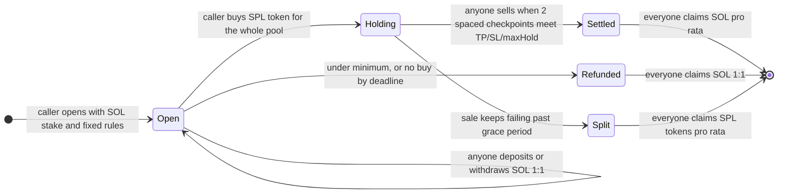
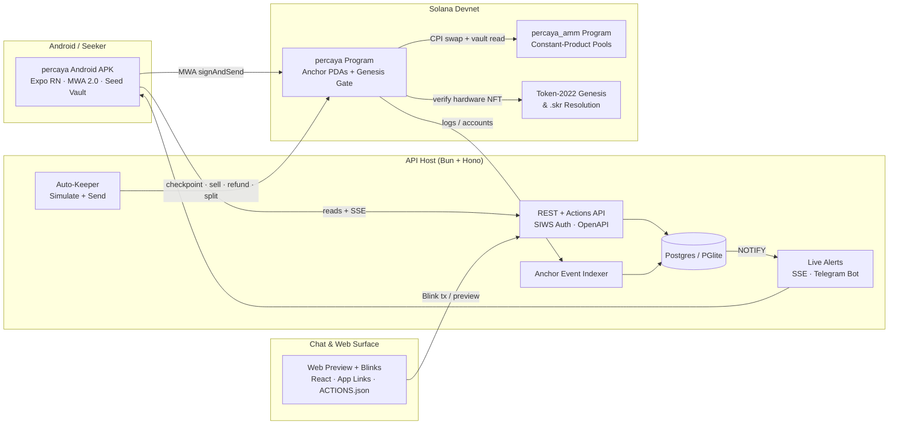

# percaya

**One buy. One sale. The same price for everyone.**

`percaya` (Indonesian for *trust*) turns a crypto call into a shared on-chain position built natively for **Solana Mobile Seeker**. A caller opens a pool on one SPL token, fixes every rule up front and puts their own SOL in first. Anyone can join from the Seeker app—or in one tap from a Telegram/X Blink—while the window is open. The pool then buys once for everyone, sells once for everyone when a rule is met, and every participant, the caller included, ends with the same percentage.

The net result goes on the caller's permanent on-chain record, bound to their hardware-attested **Seeker Genesis Token** and **`.skr` identity**, and that record decides how much they may raise next.

[](programs/percaya)
[](#deployment)
[](#seeker-integration)
[](apps/mobile)
[](apps/api)
[](LICENSE)

---

## Contents

[The problem](#the-problem) · [Why Solana Mobile & Seeker](#why-solana-mobile--seeker) · [How it works](#how-it-works) · [Worked example](#worked-example) · [Architecture](#architecture) · [Guarantees](#guarantees) · [Tech stack](#tech-stack) · [Repository](#repository) · [Known limits](#known-limits) · [Documentation](#documentation)

---

## The problem

Call groups on Telegram and X move millions in Solana memecoins with zero consequence for the caller. A caller can buy early, post the ticker, sell into their followers' buying, delete the message when it goes wrong and spin up a fresh burner wallet with a clean history. Followers carry the risk and never see the caller's actual fills.

`percaya` removes the head start instead of trying to police chat rooms. The caller's SOL rides in the same pool, at the same entry and exit price, under rules nobody can change after open, and every result stays on an on-chain record anchored to hardware identity.

---

## Why Solana Mobile & Seeker

 crypto calls happen on phones, inside mobile chat groups, with windows measured in minutes. Adapting pooled accountability to **Solana Mobile Seeker** closes the two gaps that desktop EVM builds leave open:

1. **Closing the burner-wallet reset (`Seeker Genesis Token` + `.skr`).** On a standard chain, a ruined caller spins up a fresh keypair for nothing. In `percaya`, Tiers 1–3 (`5×` to `20×` bond cap) require binding a **Seeker Genesis Token** (Token-2022 1-per-device hardware NFT) into an on-chain `GenesisRegistry` PDA. One physical Seeker device maps to one permanent track record. Rotating sub-accounts inside Seed Vault cannot spawn a clean slate, and a slash taints that Genesis Token permanently. Unverified wallets remain capped at Tier 0 (`2×` bond, `5%` max fee) and are labelled openly.
2. **From chat link to biometric Seed Vault fill in one tap.** When a caller opens a pool, `percaya` publishes a **Solana Action (Blink)** and an **Android App Link**. Followers on Seeker tap the link in Telegram or X, inspect the locked rules, and authorize the deposit with a single **Seed Vault** fingerprint prompt via **Mobile Wallet Adapter (MWA 2.0)** + Sign-In With Solana (SIWS).

---

## How it works



1. **Bond & Hardware Link.** A caller posts a SOL bond into their `CallerRecord` PDA before their first pool, and optionally links their **Seeker Genesis Token** + `.skr` handle. The bond stays locked while any call is open or holding, and the admin can slash it with a public on-chain reason.
2. **Open.** The caller selects an allowed SPL token, sets the join window, take-profit, stop-loss, max hold and profit share, and deposits their SOL stake. Every rule, timing parameter and AMM pool address is copied into the `CallPool` PDA at this transaction and never changes.
3. **Join.** While the window is open, anyone deposits SOL or withdraws it 1:1 via the Seeker app or a Solana Blink. Deposits revert if they push the pool over its cap, push buy price impact past `2%`, or dilute the caller below `5%` of the pool. The caller cannot withdraw.
4. **Buy.** After the window closes, the caller executes one swap for the entire pool. The Anchor program verifies minimum size, cap, caller share (`>= 5%`) and on-chain AMM price impact (`<= 2%`), executes the CPI swap, and records the exact SPL token delta received in `call_token_vault`.
5. **Checkpoints.** Anyone can record an on-chain checkpoint once per `checkpoint_gap`, storing what selling the entire token vault into the AMM would return right now.
6. **Sell.** Anyone can trigger the sale when the last two checkpoints (at least one `checkpoint_gap` apart, with the latest still fresh) both meet take-profit, both meet stop-loss, or agree within `2%` tolerance at `max_hold`. The program computes `min_out` directly from the checkpoints and pays `0.1%` of gross proceeds to the keeper who sent the transaction.
7. **Claim.** Each participant claims once: SOL after a sale (plus profit-only fee for the caller) or refund, or SPL tokens after a split. The final claimer sweeps any integer-division lamport/token remainder so zero dust is stranded.

### Reputation tiers

The net percentage returned to participants (`(payout - total_in) / total_in`) updates the caller's on-chain record after every settled pool.

| Tier | Requirement | Seeker Genesis | Pool cap | Max profit share |
|---|---|---|---|---|
| **0** | `< 3` settled, average net `<= 0`, unverified wallet, or ever slashed | Optional | `2 × bond` | `5%` |
| **1** | `>= 3` settled, average net `> 0`, never slashed | **Required** | `5 × bond` | `10%` |
| **2** | `>= 10` settled, average net `> 0`, never slashed | **Required** | `10 × bond` | `15%` |
| **3** | `>= 25` settled, average net `> 0`, never slashed | **Required** | `20 × bond` | `20%` |

---

## Worked example

`100 SOL` pooled (caller `10 SOL`, A `30 SOL`, B `40 SOL`, C `20 SOL`), `10%` profit share, sold for `130 SOL` gross (`1 SOL = 1,000,000,000 lamports`). Verified to the single lamport in `test_worked_example_profit`:

```text
keeper  = 130.0000 × 0.1%              =   0.1300 SOL    (130,000,000 lamports)
net     = 130.0000 − 0.1300            = 129.8700 SOL
profit  = net − 100.0000               =  29.8700 SOL
fee     = 10% of profit                =   2.9870 SOL
payout  = net − fee                    = 126.8830 SOL    shared pro rata, caller included

caller   15.6753 SOL   (12.6883 share + 2.9870 fee)
A 38.0649 SOL · B 50.7532 SOL · C 25.3766 SOL
every participant: +26.88% · on-chain record: +26.88% (+2688 bps)
```

Sold for `70 SOL` gross instead (`test_worked_example_loss`), keeper receives `0.0700 SOL`, `net = 69.9300 SOL`, `profit = 0`, `fee = 0`. Everyone—the caller included—ends at **`−30.07%`** (`-3007 bps`), and the caller's record logs a loss of `−30.07%`.

---

## Architecture



---

## Guarantees

| Guarantee | How the Anchor program enforces it |
|---|---|
| Rules are final | Every rule, timing bound and AMM pool pubkey is copied into `CallPool` at `open_call`. No instruction—admin included—mutates an active call's rules. |
| Caller is in first and stays in | `open_call` transfers the caller's SOL stake into `SolVault`; `withdraw` rejects `caller`; `deposit` and `buy` enforce `caller_stake >= 5%` of `total_in`. |
| One entry, one exit | `buy` swaps the entire `SolVault` once; `sell` swaps the entire `call_token_vault` once. No individual exit path exists while `Holding`. |
| No sale on a single-slot push | `sell` requires two on-chain checkpoints at least `checkpoint_gap` apart, with the latest at most one `checkpoint_gap` old, and computes `min_out` on-chain. |
| Real balance accounting | `buy` and `sell` measure actual `TokenAccount` and `SolVault` lamport deltas around the CPI swap; stray lamport transfers never distort share math. |
| Profit-only fee | `fee = max(net - total_in, 0) * share_bps / 10_000`. Zero fee on break-even, loss, refund or split. |
| Hardware-bound higher tiers | Tiers 1–3 require a verified Token-2022 Genesis Token bound in `GenesisRegistry` PDA; one physical device cannot reset a negative or slashed history. |
| Zero stranded dust | Refunds (`1:1`), token splits (`0` fee), and the final claimant (`claims_left == 1`) sweeping `pot - claimed`. |
| Admin has no path to pool funds | Admin instructions touch `GlobalConfig`, `AllowedToken` PDAs, and `CallerRecord` bonds (on public slash) only—never `SolVault` or `call_token_vault`. |

---

## Tech stack

| Layer | Tools |
|---|---|
| Solana Programs | Rust, Anchor `0.31`, SPL Token & Token-2022 (`spl-token-2022`), Constant-Product AMM CPI |
| Mobile (Primary) | Expo SDK 54 (React Native Android Dev Build), NativeWind, `@wallet-ui/react-native-kit` (MWA 2.0), `@solana-mobile/skr-genesis-token`, `@solana-mobile/skr-domain` |
| Web Preview & Blinks | Vite, React 18, Tailwind, Solana Actions (`@solana/actions`), Android App Links |
| Backend API & Keeper | Bun, Hono, Drizzle ORM, PostgreSQL / PGlite, `@solana/kit` / `@coral-xyz/anchor`, SIWS Ed25519 verification |
| Testing | LiteSVM / Anchor Bankrun (unit, fuzz, invariants), `bun test` (API, indexer, keeper), Maestro / Playwright |

---

## Repository

```text
programs/
  percaya/                  core pooled-call, reputation & Genesis registry Anchor program
  percaya_amm/              deterministic constant-product AMM & devnet liquidity seeder
packages/
  core/                     shared TypeScript types, IDL client, PDA derivations, demo dataset
apps/
  mobile/                   Expo React Native Android APK (MWA 2.0, Seed Vault, .skr, calm UI)
  web/                      lightweight web preview card, live docs & App Linklanding
  api/                      Hono REST + Solana Actions/Blinks, indexer, keeper, SSE, Telegram
scripts/
  seed-devnet.ts            deploys tBONK, tWIF, tSKR, Token-2022 mock Genesis & seeds pools
  move-price.ts             deterministic devnet swap script to demo live TP & SL triggers
docs/
  prd.md                    product requirements, hackathon track fit, parameters & limits
  contracts.md              Anchor PDA layouts, instruction specs, math & security invariants
  architecture.md           mobile, SIWS, Blinks, indexer, keeper & dual-mode store design
  design.md                 calm light-theme mobile design system & Android UX specification
  writeup.md                Dev3pack submission write-up & 3-minute live demo script
```

---

## Known limits

- **Second wallets & second phones.** A caller can still buy from an unrelated wallet before the pool buys. Their own SOL stake rides the pool's entry, their bond is slashable, early buyers before the pool's buy are surfaced per call, and Tiers 1–3 are locked to a 1-per-phone Seeker Genesis Token—making resets cost a physical device rather than a free keypair. We claim *costly and visible*, never *impossible*.
- **Spaced spot quotes vs TWAP.** The AMM exposes live vault reserves rather than a manipulation-resistant TWAP. Requiring two checkpoints separated by `checkpoint_gap` defeats single-slot flash loans and sandwich pushes; a price genuinely held across an entire gap counts.
- **Devnet demo liquidity & Genesis simulation.** Because Solana Devnet has no organic memecoin liquidity or Mainnet Seeker Genesis NFTs, our Devnet deployment seeds three constant-product pools (`tBONK`, `tWIF`, `tSKR`) and a configurable Token-2022 `NonTransferable` Genesis mint so every flow—including Seed Vault Simulator signing, TP/SL auto-settlement, and Genesis gating—runs live on chain.
- **Legal.** `percaya` is an accountability prototype built for a 3-day hackathon and has undergone no legal or external security audit.

---

## Documentation

- [`docs/prd.md`](docs/prd.md) — Product requirements, actors, lifecycle, Seeker mechanics and honest limits
- [`docs/contracts.md`](docs/contracts.md) — Anchor program accounts, PDA seeds, CPI swaps and invariants
- [`docs/architecture.md`](docs/architecture.md) — End-to-end mobile, Blinks, indexer and keeper architecture
- [`docs/design.md`](docs/design.md) — Android mobile-first adaptation of the *calm* design language
- [`docs/writeup.md`](docs/writeup.md) — Dev3pack Global Hackathon write-up and live demo choreography

---

## Licence

MIT.
