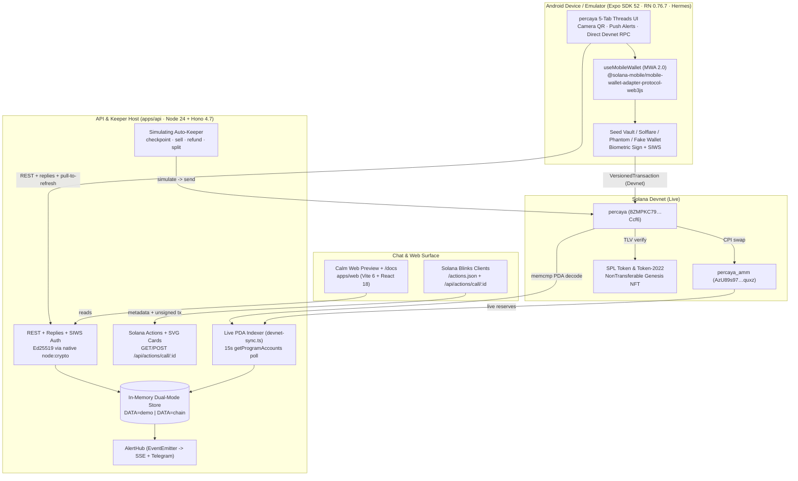

# System Architecture & Off-Chain Specification

`percaya` keeps a sharp boundary between **on-chain custody/rules (Anchor)** and **off-chain indexing, social threads, and mobile UX (Node 24 + Hono + Expo RN)**. This document explicitly separates what is **implemented and verified today** from **post-hackathon roadmap items**.

---

## 1. End-to-end topology (Implemented)

---

## 2. Implemented components (Built & Verified)

### 2.1 Shared Core (`packages/core`, `@percaya/core`)
- Pure TypeScript types (`CallDetail`, `CallerRecord`, `ThreadReply`, `ParticipantPosition`, `ProtocolParams`).
- Exact `BigInt` mirror of on-chain `u128` math (`quoteBuy`, `quoteSell`, `impactBps`, `maxImpactSol`, `computeTier`, `computeSettlement`, `evaluateSellRule`, `computeParticipantClaim`, `formatSolFloor`, `formatSignedPct`) with **6/6 tests passing** (`math.test.ts`).
- Deterministic PDA seed builders (`PDA_SEEDS`) + synced Anchor `1.2` JSON IDLs (`src/idl/percaya.json`, `src/idl/percaya_amm.json`) + live Devnet addresses (`src/devnet-deployment.json`).

### 2.2 Backend API, Indexer & Auto-Keeper (`apps/api`, Node.js 24 + Hono 4.7)
- **Dual-mode store (`DATA=demo` vs `DATA=chain`):**
  - `DATA=demo`: Deterministic fixture calls (`Open`, `Holding`, `Settled` `+26.88%` profit, `Settled` `−30.07%` loss, slashed caller, Seeker-verified callers, and pre-seeded thread replies).
  - `DATA=chain` (`npm run dev:api:chain`): Runs `startDevnetSyncLoop` (`apps/api/src/devnet-sync.ts`) polling Solana Devnet every 15s via `getProgramAccounts` filtered by 8-byte Anchor discriminators, decoding `AmmPool`, `CallerRecord`, `Position`, and `CallPool` Borsh layouts directly into the store.
- **Simulating Auto-Keeper (`devnet-sync.ts`):** When a keeper keypair is present (`KEEPER_SECRET_KEY` or `~/.config/solana/id.json`), automatically simulates and submits `checkpoint()`, `sell()` (when 2 spaced checkpoints qualify), `refund()`, and `split()`.
- **Sign-In With Solana (SIWS, `siws.ts`):** Zero third-party auth SaaS. Verifies 64-byte Ed25519 signatures over canonical SIWS nonce challenges using Node 24's native `node:crypto` and issues `HMAC-SHA256` bearer tokens.
- **Skin-in-the-Game Thread Replies (`GET/POST /api/calls/:id/replies`):** Automatically looks up the commenter's on-chain `Position` for that `callId` and tags the reply with `depositedLamports` (`In Pool · X SOL` vs `Spectator`).
- **Solana Actions / Blinks (`actions.ts`):** Full CORS-compliant `/actions.json`, `GET/POST /api/actions/call/:id` (returns serialized `VersionedTransaction` combining `init_position` + `deposit` after enforcing cap, `5%` caller ratio, and `2%` buy impact), and server-rendered calm SVG cards (`/api/calls/:id/card.svg`).
- **Android App Links (`/.well-known/assetlinks.json`):** Maps `https://percaya.app/c/*` to package `com.percaya.seeker`.
- **Live Alerts (`GET /api/me/stream` + optional Telegram Bot):** SSE stream with heartbeat and optional `TELEGRAM_BOT_TOKEN` push.

### 2.3 Mobile App (`apps/mobile`, Expo SDK 52 · React Native 0.76.7 · Hermes)
- **5-Tab Threads UI (`App.tsx`):** `Home` (`For you (Newest)` & `Following` feeds with vertical thread connectors and inline reply previews), `Callers` (directory + token filter), `+ Post` (3-step immutable call wizard), `Activity` (alerts), and `Profile` (live Devnet SOL balance, real on-chain `CallerRecord` stats, `Claim Test SOL` faucet button, and `Disconnect`).
- **On-Device Direct Devnet Engine (`src/chain-direct.ts`):** When no hosted/local API is reachable (e.g., cold-installed APK on a judge's Seeker or Android emulator), reads `AmmPool`, `CallerRecord`, `Position`, and `CallPool` PDAs directly from `https://api.devnet.solana.com` using pure `DataView` Borsh decoding and builds `open_call`, `deposit`, `checkpoint`, `sell`, and `claim` `VersionedTransaction`s on-device. When an API (`EXPO_PUBLIC_API_URL` or local `8787`) is reachable, prefers the API for Thread Replies & SSE.
- **Idiomatic `useMobileWallet` Hook (`src/hooks/useMobileWallet.ts` & `src/mwa.ts`):** Follows `solana-mobile-skills` patterns (`chain: 'solana:devnet'`, 1-prompt SIWS with automatic fallback to standard `authorize` for Fake Wallet / legacy MWA wallets, `signAndSendTransactions` with Devnet RPC receipt verification for Solflare Android's post-broadcast WebSocket disconnect, and zero silent mock logins).
- **Native Phone Hardware Features:**
  - **Camera QR Call Scanner & Call QR Sheet (`src/components/CallQr.tsx`, `src/call-links.ts`):** `expo-camera` scans `percaya://c/:id` and `https://percaya.app/c/:id` QR codes to jump straight into a pool; every Call Detail renders a scannable SVG QR (`react-native-qrcode-svg`).
  - **Android Local Push Notifications (`src/notifications.ts`, `src/call-diff.ts`):** `expo-notifications` triggers system notifications when watched or joined calls transition to `Holding`, `Settled` (with signed net return), `Refunded`, or `Split`. Covered by **6/6** unit tests (`npm --workspace @percaya/mobile run test`).
- **dApp Store Ready:** Includes `apps/mobile/dapp-store/config.yaml` and supports standalone local Gradle builds (`./gradlew assembleRelease`).

### 2.4 Web Preview (`apps/web`, Vite 6 + React 18 + Tailwind 3.4)
- Read-only calm preview of `/`, `/c/:id` (with Blink copy + `percaya://c/:id` Android deep link), and live `/docs` reading parameters from `/api/config`.

---

## 3. REST & Actions API surface

| Method & Path | Auth | Purpose |
|---|---|---|
| `GET /api/health` | Public | Mode (`demo`/`chain`), cluster, live Program IDs |
| `GET /api/config` | Public | Live protocol parameters & allowed tokens |
| `GET /api/calls` · `GET /api/calls/:id` | Public | Newest-first calls (`no_ranking`) & full detail |
| `GET /api/calls/:id/replies` · `POST /api/calls/:id/replies` | Public / SIWS | Thread replies auto-tagged `In Pool` vs `Spectator` |
| `GET /api/calls/:id/card.svg` | Public | Calm editorial SVG share/Blink card |
| `GET /api/callers` · `GET /api/callers/:pubkey` | Public | Directory ordered by `lastActive` & full profile |
| `GET /api/auth/nonce` · `POST /api/auth/verify` | Public | SIWS challenge & Ed25519 signature verification |
| `POST /api/me/follow` · `POST /api/me/watch` | SIWS | Follow caller or watch call |
| `GET /api/me/alerts` · `GET /api/me/stream` | Public / SSE | Alert inbox & live SSE stream |
| `GET /actions.json` · `GET/POST /api/actions/call/:id` | Public | Solana Actions / Blinks endpoints |
| `POST /api/tx/open-call` · `POST /api/tx/:action/:id` | Public | Unsigned `VersionedTransaction` builders (`open_call`, `checkpoint`, `sell`, `claim`) |
| `POST /api/devnet/issue-sgt` | Public | Atomic Devnet Token-2022 `NonTransferable` SGT mint + `verify_seeker_genesis` tx |
| `POST /api/faucet` | Public (rate-limited) | Devnet Judge micro-faucet (`0.08 SOL` / wallet / 6h) for 0-SOL wallets |
| `GET /.well-known/assetlinks.json` | Public | Android App Links verification |

---

## 4. Post-hackathon roadmap & Mainnet `$SKR` business alignment

To keep the 72-hour build verifiable and honest, the following items are deferred to Mainnet sprints:
- **Sustainable Mainnet Business Model & `$SKR` Buy-and-Burn Alignment:** On Mainnet, `percaya` charges `0%` on losses, refunds, or splits, and takes a `1%` protocol share strictly from profitable caller performance fees. Protocol revenue is allocated into **`SKR` (`SKRbvo6Gf7GondiT3BbTfuRDPqLWei4j2Qy2NPGZhW3`) Buy & Burn and Guardian Staking** (`SKRskrmtL83pcL4YqLWt6iPefDqwXQWHSw9S9vz94BZ`)—directly mirroring Solana Mobile's Seed Vault revenue buy-and-burn model (`solanamobile.com/skr`).
- **Mainnet Seeker Genesis Group & `.skr` Domains:** Bind `verify_seeker_genesis` to the official Mainnet Seeker Genesis Token Group (`GT22s89nU4iWFkNXj1Bw6uYhJJWDRPpShHt4Bk8f99Te` via `@solana-mobile/skr-genesis-token` + `GenesisRegistry` mint-binding so transferring an SGT across internal Seed Vault sub-accounts cannot reset history) and AllDomains `.skr` resolution (`@solana-mobile/skr-domain`).
- **Mainnet Raydium CPMM (`cp-swap`) / Jupiter CPI adapter** replacing `percaya_amm`.
- **Durable PostgreSQL + Drizzle ORM persistence** & automated `EarlyBuyers` pre-swap funding scanner.
- **Squads v4 multisig slashing** in place of the single Devnet admin key.
