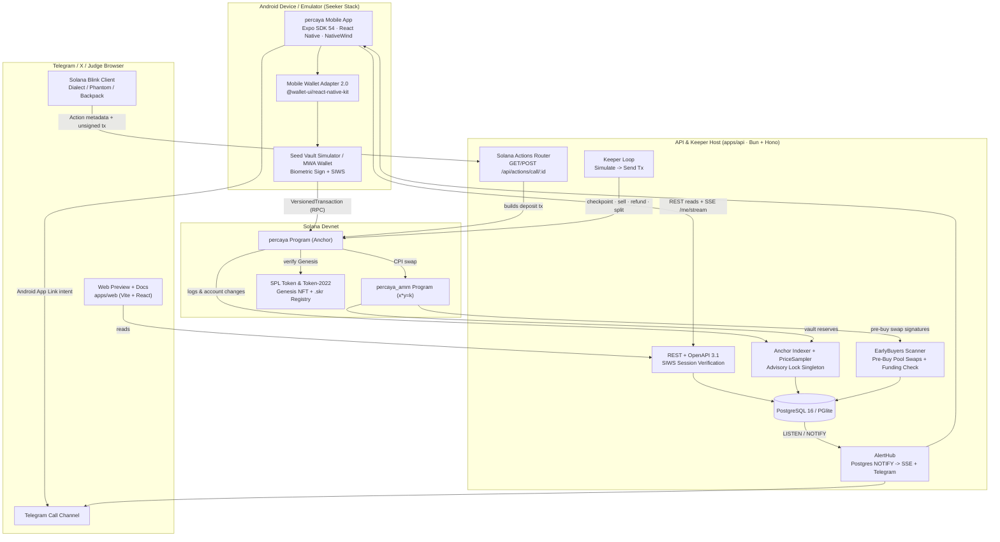

# System Architecture & Off-Chain Specification

`percaya` preserves the proven separation of concerns from `TrustPool` (Monad) while replacing every EVM/Privy dependency with native **Solana + Solana Mobile Stack (SMS)** primitives. This keeps the codebase compact enough for a single engineer to ship in 72 hours and clean enough for rigorous review.

---

## 1. End-to-end topology



---

## 2. Monorepo structure & code reuse strategy

```text
percaya/
  Anchor.toml                     workspace config (localnet + devnet)
  package.json                    Bun workspaces root
  programs/
    percaya/                      Rust Anchor pooled-call & Genesis registry program
    percaya_amm/                  Rust Anchor constant-product AMM & devnet pools
  packages/
    core/                         @percaya/core: types, Anchor IDL, PDA helpers, math, demo data
  apps/
    api/                          @percaya/api: Hono REST, Blinks, indexer, keeper, SSE, Telegram
    mobile/                       @percaya/mobile: Expo RN Android APK (primary Seeker dApp)
    web/                          @percaya/web: lightweight share preview, Blink host & live /docs
  scripts/
    seed-devnet.ts                mints tBONK/tWIF/tSKR + Devnet Genesis NFT, seeds AMM + history
    move-price.ts                 swaps against percaya_amm to trigger live TP or SL in demos
    local-stack.ts                boots solana-test-validator + deploys programs + runs API (PGlite)
```

### Dual-mode store (`DATA=demo` vs `DATA=chain`)
Carried directly from `TrustPool`:
- **`DATA=demo`:** Serves deterministic in-memory fixtures (`packages/core/src/demo.ts`) covering every call state (`Open`, `Holding`, `Settled` profit, `Settled` loss, `Refunded`, `Split`, slashed caller, Seeker-verified `.skr` caller). Allows parallel mobile UI development and instant offline UI testing with zero RPC dependency.
- **`DATA=chain`:** Reads from PostgreSQL (production) or PGlite (local validator / CI), hydrated exclusively by the Anchor event/account indexer so API responses mirror on-chain state.

---

## 3. Solana Mobile & Seeker integration layer (`apps/mobile`)

### 3.1 Wallet connection & Sign-In With Solana (SIWS)
No third-party auth SaaS (no Privy). Authentication uses **Mobile Wallet Adapter 2.0** native `signIn`:
1. User taps **Connect Seeker Wallet** when performing an authenticated action (browsing never requires login).
2. `apps/mobile` invokes `transact()` via `@wallet-ui/react-native-kit` (backed by `@solana-mobile/mobile-wallet-adapter-protocol-web3js`) passing a ` SolanaSignInInput` payload (`domain`, `statement`, `nonce` fetched from `GET /api/auth/nonce`, `issuedAt`).
3. Inside the **Seed Vault Simulator** (or physical Seeker Seed Vault / Solflare / Phantom on standard Android), the user authorizes connection + SIWS in **one biometric/PIN prompt**.
4. `POST /api/auth/verify` validates the Ed25519 signature over the canonical SIWS message and issues a lightweight `HS256` / `EdDSA` session token stored in `expo-secure-store` for off-chain preferences (follows, watchlists, SSE `/me/stream`).
5. Every value-moving action (`post_bond`, `open_call`, `deposit`, `withdraw`, `buy`, `checkpoint`, `sell`, `claim`) builds an Anchor `VersionedTransaction` with Priority Fees (`ComputeBudgetProgram`) and dispatches via MWA `signAndSendTransactions`.

### 3.2 Seeker Genesis Token & `.skr` identity resolution (with Devnet simulator fallback)
Because physical Seeker Genesis NFTs and `.skr` AllDomains records live on Solana Mainnet while hackathon execution runs on Devnet, `percaya` uses an explicit **Dual-Cluster Identity Resolver**:

| Primitive | Mainnet behavior (`CLUSTER=mainnet-beta`) | Devnet Hackathon Demo (`CLUSTER=devnet`) |
|---|---|---|
| **Seeker Genesis Token** | Client checks `@solana-mobile/skr-genesis-token` (`hasSeekerGenesisToken`); Anchor `GlobalConfig.genesis_authority` points to official Seeker Genesis collection authority | `seed-devnet.ts` deploys a real **SPL Token-2022 Mint** with the **`NonTransferable` extension** enabled (`DevnetSeekerGenesis`). Mobile app includes a **"Mint Devnet Seeker Genesis (Simulator)"** developer helper inside the Profile sheet so judges on any Android phone/emulator can test hardware-bound Tier 1+ verification live on chain |
| **`.skr` Domain** | Resolves `getPrimarySkrDomain(rpc, pubkey)` via `@solana-mobile/skr-domain` (`alice.skr`) | Queries Mainnet RPC first (if wallet holds a real `.skr`, displays it), then falls back to an on-chain/API Devnet `.skr` alias table seeded for demo accounts (`budi.skr`, `rina.skr`, `naya.skr`) clearly badged `(devnet .skr)` |

---

## 4. Solana Actions (Blinks) & Android App Links (`apps/api` + `apps/web`)

Every call generates a canonical URL: `https://<host>/c/:callId`.

1. **On Android with `percaya` APK installed (`assetlinks.json` App Links):**  
   Tapping `https://<host>/c/12` in Telegram or X opens `apps/mobile` directly to `CallDetailScreen(callId = 12)` with the Seed Vault deposit sheet ready.
2. **In Blink-aware clients (X, Dialect, Phantom browser) via `/actions.json`:**  
   - `GET /actions.json` maps `/c/*` -> `/api/actions/call/*`.
   - `GET /api/actions/call/:id` returns an `ActionGetResponse`:
     - Dynamic PNG card rendered via `@resvg/resvg-js` showing token, caller `.skr` & tier record, locked TP/SL/max-hold rules, live fill bar (`1.40 / 2.00 SOL`), and remaining window countdown.
     - Quick-deposit buttons: `Deposit 0.1 SOL`, `Deposit 0.25 SOL`, and parameterized `Custom SOL amount` (disabled automatically if `state != Open` or `now >= window_end`).
   - `POST /api/actions/call/:id?amount=0.25` validates live pool cap & `2%` impact check, constructs an unsigned `VersionedTransaction` calling `percaya::deposit`, and returns base64 `ActionPostResponse`.
3. **In standard mobile/desktop browsers (`apps/web`):**  
   Renders a fast read-only preview of the call's locked rules, live price chart since entry, early-buyer check, caller record, `"Download Android APK"` button, and `"Open in Seeker"` deep-link button.

---

## 5. Backend services (`apps/api`)

### 5.1 Database schema (Drizzle ORM — PostgreSQL 16 & PGlite compatible)
- `callers`: `pubkey` (PK), `skr_name`, `genesis_mint`, `is_seeker_verified`, `bond_lamports`, `withdraw_ready_at`, `tier`, `settled`, `losses`, `negligent`, `refunded`, `split`, `slashes`, `active`, `last_active`, `sum_net_bps`.
- `calls`: `call_id` (PK), `pda`, `caller`, `token_mint`, `token_symbol`, `amm_pool`, `state`, `settle_reason`, `opened_at`, `window_end`, `buy_deadline`, `bought_at`, `hold_until`, `rules_json`, `total_in`, `caller_stake`, `depositors_count`, `tokens_bought`, `prev_cp_val`, `prev_cp_at`, `last_cp_val`, `last_cp_at`, `live_quote_val`, `live_cap_lamports`, `gross_out`, `payout`, `fee`, `net_return_bps`, `thesis`, `buy_tx_sig`, `sell_tx_sig`.
- `positions`: `(call_id, participant)` (PK), `deposited`, `claimed`, `claim_tx_sig`.
- `early_buyers`: `(call_id, buyer_pubkey)` (PK), `slot`, `tx_sig`, `tokens_acquired`, `funded_by_caller` (`bool`), `funding_tx_sig`.
- `follows` & `watches` & `alerts`: off-chain user subscriptions keyed by SIWS-verified `pubkey`.
- `sync_cursor`: `id`, `last_processed_sig`, `last_slot`.

### 5.2 Indexer, PriceSampler, Keeper & EarlyBuyers
A single leader instance (coordinated via Postgres advisory lock `pg_try_advisory_lock(737229)`) runs four background loops:

1. **Anchor Indexer (`2s` poll / WebSocket `onLogs`):**  
   Parses Anchor `emit!()` events (`BondPosted`, `GenesisVerified`, `BondSlashed`, `CallOpened`, `Deposited`, `Withdrawn`, `PoolBought`, `Checkpointed`, `PoolSold`, `PoolRefunded`, `PoolSplit`, `Claimed`) and reconciles the corresponding PDA state atomically into Drizzle, firing `NOTIFY percaya_events` for SSE & Telegram.
2. **PriceSampler (`10s` interval):**  
   Reads `AmmPool` reserves for every `Open` and `Holding` call to update `live_cap_lamports` (closed-form `2%` impact cap) and `live_quote_val` (unrealized sell quote, explicitly marked as an indicative quote in UI).
3. **Auto-Keeper (`5s` interval):**  
   Inspects all active calls:
   - `Holding` where `now >= last_cp_at + checkpoint_gap`: simulates `checkpoint()`, then sends if simulation succeeds.
   - `Holding` where two valid checkpoints satisfy TP, SL, or MaxHold agreement: simulates `sell()`, sends, and collects `0.1%` keeper reward into the keeper keypair.
   - `Open` past `window_end` (`< min_pool`) or past `buy_deadline`: simulates and sends `refund()`.
   - `Holding` past `hold_until + split_grace`: simulates and sends `split()`.
   *Note:* Every keeper action is also exposed as a permissionless button inside the mobile app (`Record checkpoint`, `Sell & earn 0.1%`, `Refund pool`, `Split tokens`) so the protocol never depends on our server staying online.
4. **EarlyBuyers Scanner (triggered on `PoolBought`):**  
   Fetches the last `50` signatures on `amm_pool` preceding `buy_tx_sig` (`getSignaturesForAddress` + `getParsedTransactions`), extracts wallets receiving `token_mint` within `15` minutes before `buy`, and checks recent SOL transfers from `call.caller` (`1-hop` direct funding flag).

---

## 6. REST & SSE API surface

| Method & Path | Auth | Purpose |
|---|---|---|
| `GET /api/health` | Public | Chain sync status, slot lag, keeper status, program IDs |
| `GET /api/config` | Public | Live `GlobalConfig` parameters and allowed tokens |
| `GET /api/calls` | Public | Newest-first call list (`state`, `token`, `caller`, cursor pagination; never ranked) |
| `GET /api/calls/:id` | Public | Full call detail, checkpoints, quote history, positions, early buyers |
| `GET /api/calls/:id/card.png` | Public | Server-rendered calm OpenGraph / Blink PNG image |
| `GET /api/callers` | Public | Directory ordered by `last_active` |
| `GET /api/callers/:pubkey` | Public | Caller record, tier limits, `.skr` + Genesis status, call & slash history |
| `GET /api/auth/nonce` · `POST /api/auth/verify` | Public | SIWS challenge & Ed25519 signature verification |
| `POST /api/me/follow` · `POST /api/me/watch` | SIWS | Follow a caller or watch a specific call |
| `GET /api/me/alerts` · `GET /api/me/stream` | SIWS | Alert inbox & real-time Server-Sent Events stream |
| `GET /actions.json` · `GET/POST /api/actions/call/:id` | Public | Solana Actions / Blinks specification endpoints |
