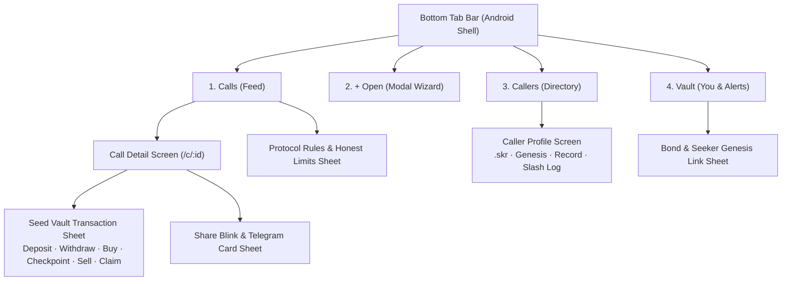

# Mobile-First Design Specification (`percaya` for Android & Seeker)

One word: **calm**.

Most Solana mobile apps dress trading in dark-mode neon, glowing gradients, and casino motion. `percaya` sells accountability, and accountability looks unconvincing in a loud wrapper.

**The litmus test for every mobile screen:** If a call lost `−30.07%`, does the screen still feel quiet, legible, and honest? A design that only works when numbers are green is wrong.

---

## 1. Visual direction & mobile adaptation principles

Adapted from the desktop web system (`TrustPool` 10 Oct 2026) into a **thumb-first Android native interface** built with Expo React Native & NativeWind:

1. **Daylight editorial surface (`Light Theme Only`).** High-contrast slate ink (`#0F1D24`) on cool paper ground (`#F2F5F7`) with crisp white cards (`#FFFFFF`). Under outdoor glare or stage cameras during a live mobile demo, light surfaces with `AA+` contrast read cleaner than low-contrast dark grey cards.
2. **Thumb-zone primary actions.** Desktop sidebars (`248px`) and multi-column tables are replaced by a **4-tab bottom navigation bar** and **sticky bottom action bars** positioned for one-handed right/left thumb reach, culminating in the native Android **Seed Vault / MWA bottom sheet**.
3. **Dense vertical rhythm without horizontal scrolling.** Wide tables become structured 2-line rows (`CallCard` and `PositionRow`) where token/caller context sits left and signed tabular numbers sit right.
4. **Hardware provenance made quiet, not flashy.** A verified **Seeker Genesis Token** or **`.skr` handle** appears as a crisp, understated hardware pill (`budi.skr · Seeker Genesis`), never a glowing VIP trophy.

---

## 2. Design tokens (`apps/mobile/tailwind.config.js`)

Identical semantic palette across `apps/mobile`, `apps/web` preview, and `@resvg` Blink cards:

| Token | Hex | Mobile usage |
|---|---|---|
| `bg` | `#F2F5F7` | Screen background (`SafeAreaView` ground) |
| `surface` | `#FFFFFF` | Cards, bottom tab bar, bottom sheets, sticky action dock |
| `subtle` | `#F6F8FA` | Rule breakdown insets, input wells, segmented filter tracks |
| `line` / `line-strong` | `#E2E8EC` / `#CCD5DC` | `1px` hairline dividers and card borders |
| `ink` / `ink-2` / `ink-3` | `#0F1D24` / `#364852` / `#66777F` | Primary copy & primary CTA (`ink`), body labels (`ink-2`), metadata (`ink-3`, minimum contrast floor) |
| `accent` | `#1F6E9C` | Brand slate-blue anchor (passes WCAG AA with `#FFFFFF` text) |
| `accent-strong` / `accent-deep` | `#165578` / `#123F5A` | Pressed state, text over soft blue fills |
| `accent-fill` / `accent-soft` | `#DBEAF4` / `#EDF5FA` | Active filter chip, selected wizard option, Seeker Genesis verified pill, unread alert bar |
| `gain` / `gain-fill` | `#0A8A5F` / `#DCF3E8` | Positive net returns (`+26.88%`) only |
| `loss` / `loss-fill` | `#D23A2F` / `#FDE8E5` | Negative net returns (`−30.07%`) and slash records only |

### Color discipline per screen
- Each screen carries **at most one solid `accent` (`#1F6E9C`) anchor surface**:
  - **Feed screen:** `"Closing soon"` live window banner at top when an open pool is within 3 minutes of `window_end`.
  - **Call detail:** Active window or max-hold countdown header strip.
  - **Vault (`You`) tab:** Caller Bond & Seeker Genesis hardware status card.
- Primary screen CTA (`Join pool`, `Open call`, `Buy for pool`, `Sell now`, `Claim SOL`) uses `accent` (`#1F6E9C`) or `ink` (`#0F1D24`). Secondary actions (`Withdraw`, `Record checkpoint`, `Share Blink`) use `surface` (`#FFFFFF`) with `1px` `line-strong` border.

### Typography & numeric formatting
- **UI Sans:** `Geist` (fallback `Inter` / Android `sans-serif-medium`), tight tracking on headings (`-0.02em`).
- **Tabular Numbers (`.num`):** `Geist Mono` (`fontVariant: ['tabular-nums']` in React Native) on **every** SOL amount, bps rule, countdown timer, tier multiple, and percentage.
- **Strict number rules:**
  - Every return percentage carries an explicit sign (`+26.88%`, `−30.07%`, `+0.00%`), using true minus `−` (`U+2212`), even when colored.
  - SOL amounts round **down** (`floor`), never up (`12.6883 SOL`).
  - Every return states its baseline: `"+26.88% net after fee"` or `"−4.10% indicative quote vs pool entry"`.
  - Pubkeys display `.skr` primary name first (`budi.skr`), falling back to middle-truncated base58 (`7xKX…9fQp`).

---

## 3. Mobile information architecture (4-Tab Android Shell)

Browsing never gates behind wallet connection. MWA authorization triggers contextually the moment the user taps an action that mutates state or saves a watch/follow.

### Screen-by-screen mobile layout

#### 1. `Calls` Tab (Home & Explore merged for mobile clarity)
- **Sticky top bar (`56dp`):** Lowercase `percaya` Vessel mark + wordmark on left; live Devnet dot + `?` Rules icon + Wallet/SIWS pill (`budi.skr`) on right.
- **Horizontal state tabs (sliding indicator):** `All` · `Open` · `Holding` · `Settled` · `Refunded`.
- **Token filter chips:** `All tokens` · `tBONK` · `tWIF` · `tSKR` · caption on right: `Newest first · No ranking`.
- **`CallCard` anatomy (`16dp` radius, `16dp` padding, `12dp` gap):**
  - **Row 1 (Caller & State):** Deterministic `CallerAvatar` + `budi.skr` + `Seeker T1` subtle pill (`Unverified T0` in `subtle` grey if no Genesis NFT) | `StateTag` (`Open · 04:12 left` in `accent`, `Holding` in `ink`, `Settled` in `subtle`).
  - **Row 2 (Token & Result/Fill):** `TokenIcon` + `$tBONK` + 1-line `thesis` (`maxLines={2}`) | Right-aligned `.num` primary metric (`1.45 / 2.00 SOL` progress bar while `Open`; `+18.40% quote` while `Holding`; **`+26.88%`** or **`−30.07%`** net when `Settled`).
  - **Row 3 (Locked Rules Strip):** `subtle` inset bar with lock icon: `TP +25% · SL −12% · Max 15m · Fee 10% · Fixed at open`.

#### 2. `Call Detail` Screen (Deep-link target `/c/:id`)
- **Top status block:** Live countdown (`Window closes in 02:48` or `Max hold ends in 11:20`) or final settlement banner (`Settled via Take-Profit · +26.88% net to all participants`).
- **Position & Fill card:** Pool fill vs live `2%` impact cap (`cap_of`), caller's locked stake (`10.0% >= 5% min`), your own deposit & projected/claimable SOL.
- **Checkpoints & Price chart:** Clean single-line SVG sparkline (`react-native-svg`) from pool entry `1.00×` with horizontal dashed lines for `TP` and `SL`, plus the two on-chain `Checkpoint` dots (`CP1`, `CP2`) showing why `Sell` is or isn't unlocked yet.
- **Rules panel (`Fixed at open`):** Lock icon + immutable parameters read from `CallPool` PDA.
- **Transparency accordion:** `Participants (4)` + `Early buyers before pool swap (0 flagged)` + `On-chain PDAs & Solscan links`.
- **Sticky bottom thumb bar (`72dp` + Android navigation inset):**
  - During `Open` (joiner): `[ Withdraw ]` + `[ Join Pool (Seed Vault) ]` -> slides up amount keypad (`0.05`, `0.1`, `0.25`, `Max safe cap`) showing real-time price impact (`0.84% / 2.00% max`).
  - Post-window (`Open`, caller): `[ Execute 1-Tx Pool Buy ]`.
  - During `Holding` (anyone): `[ Record Checkpoint ]` (with cooldown timer) + `[ Sell & Earn 0.1% ]` (enabled immediately when 2 checkpoints qualify).
  - Terminal (`Settled` / `Refunded` / `Split`): `[ Claim 12.6883 SOL ]`.

#### 3. `+ Open` Modal (3-Step Mobile Call Wizard)
Condensed from desktop's 4 steps into 3 fast mobile steps with zero keyboard friction:
- **Step 1 — Token & Stake:** Pick allowed SPL token (`tBONK`, `tWIF`, `tSKR`), see live pool liquidity & `2%` impact ceiling, tap stake preset (`0.05`, `0.1`, `0.2 SOL`), auto-checks caller bond (`>= 0.2 SOL`) & `>= 5%` caller ratio.
- **Step 2 — Immutable Rules:** Preset chips + fine steppers for `Window` (`2m`, `5m`, `10m`), `Take-Profit` (`+15%`, `+25%`, `+50%`, `None`), `Stop-Loss` (`−10%`, `−15%`, `−25%`), `Max Hold` (`5m`, `15m`, `30m`), `Profit Share` (bounded by live Tier `0..3`), and optional `280-char` plain thesis.
- **Step 3 — Lock Review & Sign:** Live preview of the exact `CallCard` + explicit warning: *"Rules, stake, and exit bounds cannot be edited or cancelled once signed."* -> **Sign in Seed Vault**. Immediately opens the **Share Blink / Telegram sheet** upon confirmation.

#### 4. `Callers` Tab & `Caller Profile`
- Ordered strictly by `last_active` (`No leaderboard`).
- Shows `.skr` handle, `Seeker Genesis Verified` hardware badge (or `Unverified Wallet`), Tier (`T0`–`T3`), `Settled / Losses / Negligent / Slashes`, and `Avg Net Return` (`+14.20%` or `−8.45%`).
- Slash log displays exact timestamp, slashed SOL amount, and public on-chain reason string.

#### 5. `Vault` (`You`) Tab
- **Solid `accent` (`#1F6E9C`) Caller Console Card:** Active SOL bond, Tier progress (`2 / 3 settled calls to Tier 1`), and **Seeker Genesis Hardware Link** button (supports real Token-2022 check + 1-tap *"Mint Devnet Simulator Genesis"* button when running on Devnet).
- **Your Active & Claimable Positions:** 1-tap `Claim` buttons for settled/refunded pools.
- **Live Alerts Feed:** Real-time SSE notifications (`Pool bought`, `Checkpoint 1/2 hit TP`, `Pool settled +26.88% — Claim ready`).

---

## 4. Android motion, haptics & resilience rules

1. **Never start content at `opacity: 0`.** Carry forward the hard-earned rule from `TrustPool`: animate `translateY` (`8dp -> 0`) with `react-native-reanimated` springs (`damping: 22, stiffness: 260`), never gate visibility on exit animations or `opacity: 0` initial states that can stall across Android Activity lifecycle pauses (such as returning from the external MWA / Seed Vault intent activity!).
2. **Subtle tactile haptics (`expo-haptics`), zero celebration:**
   - `ImpactFeedbackStyle.Light` on chip selection and Seed Vault intent handoff.
   - `NotificationFeedbackType.Success` (single quiet tap) when an on-chain transaction confirms—identical whether claiming a profit or claiming a loss.
   - **Zero** confetti, fireworks, sound effects, streaks, or badges.
3. **MWA Activity-switch state persistence:** On Android, invoking Mobile Wallet Adapter backgrounds or overlays the React Native Activity while Seed Vault prompts for fingerprint/PIN. Wizard drafts and open bottom-sheet inputs persist in lightweight Zustand state so nothing resets during signing.

---

## 5. Product & copy rules (Non-negotiable)

| Write | Never write |
|---|---|
| `One buy. One sale. The same price for everyone.` | `Ape together` / `Pump with top callers` |
| `This call lost −30.07% net` | `This call underperformed` |
| `12 settled · 5 at a loss · +8.14% avg net` | `58% win rate` / `Top #1 Caller` |
| `Seeker Genesis linked · 1 record per device` | `100% Sybil-proof` / `Guaranteed safe` |
| `Indicative AMM sell quote` | `Unrealized profit` / `Projected gain` |

Banned words across UI, commits, README, and demo pitch: *"move the market"*, *"guaranteed"*, *"risk-free"*, *"moon"*, *"ape in"*, *"win rate"*, *"leaderboard"*, *"compliant"*.

---

## 6. Brand & logo (`percaya`)

- **Wordmark:** Always lowercase **`percaya`** in `Geist SemiBold` (`-0.03em` tracking).
- **Symbol ("Vessel"):** Retained from `TrustPool`'s Concept A—a clean cross-section vessel containing a single flat horizontal water line (`#1F6E9C`), representing **one shared entry/exit price line** for everyone inside the pool. Minimum size `16dp`; Android adaptive launcher icon uses `#FFFFFF` foreground vessel on `#0F1D24` / `#1F6E9C` squircle ground.
